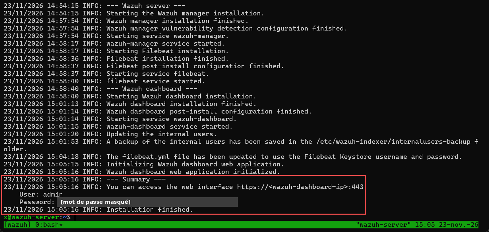
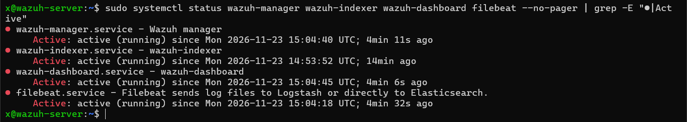

# EDR – Wazuh sur VM Debian

Runtrack La Plateforme – Alexandre Kegresse – soutenance du 27/11/2026

Objectif : installer un EDR open source (Wazuh), surveiller des VM Debian, simuler une attaque, écrire mes propres règles de détection et automatiser une réponse.

## Sommaire

1. [Job 01 – C'est quoi un EDR ?](#job-01--cest-quoi-un-edr-)
2. Job 02 – Installation du serveur Wazuh
3. Job 03 – VM Debian, agents et règles de surveillance
4. Job 04 – Attaque simulée et rapport
5. Job 05 – Règle de détection personnalisée
6. Job 06 – Réponse active automatisée

## Le labo

| Machine | Rôle |
|---|---|
| PC hôte | Windows 11, VMware Workstation, Intel Celeron N5100 (4 cœurs), 16 Go de RAM |
| wazuh-server | Serveur Wazuh (manager + indexer + dashboard) |
| debian-agent1 | Machine surveillée, victime de l'attaque |
| debian-agent2 | Machine surveillée, sert aussi à lancer l'attaque |

## Job 01 – C'est quoi un EDR ?

**EDR = Endpoint Detection and Response.** C'est un logiciel de sécurité installé sur les postes et les serveurs (les « endpoints »). Il **surveille** ce qui se passe sur la machine, **détecte** les comportements suspects et peut **réagir** tout seul.

### Comment ça marche

```
 Poste / serveur          Serveur EDR                 Analyste (SOC)
 ┌────────────┐  logs   ┌──────────────────┐ alerte  ┌──────────────┐
 │   agent    │ ──────▶ │ règles de        │ ──────▶ │ tableau de   │
 │            │         │ détection        │         │ bord         │
 │            │ ◀────── │ réponse active   │         │              │
 └────────────┘ action  └──────────────────┘         └──────────────┘
```

1. Un **agent** sur chaque machine collecte : fichiers modifiés, processus lancés, connexions, logs système.
2. Le **serveur** compare ces événements à des **règles**. Si une règle correspond → **alerte**.
3. L'EDR peut lancer une **réponse automatique** : bloquer une IP, tuer un processus, supprimer un fichier.
4. Les événements sont **gardés** : on peut enquêter après l'incident (qui, quand, quoi).

### Antivirus, EDR, SIEM : la différence

| Outil | Ce qu'il fait |
|---|---|
| Antivirus | Reconnaît des fichiers malveillants **déjà connus** (signatures) |
| EDR | Regarde le **comportement** sur la machine, détecte aussi l'inconnu, et peut réagir |
| SIEM | Centralise les logs de **tout** le SI (réseau, serveurs, applis) pour corréler et analyser |

Un EDR ne remplace pas le SIEM : en entreprise, l'EDR envoie ses alertes au SIEM.

### Les solutions connues

- **Commerciales** : CrowdStrike Falcon, Microsoft Defender for Endpoint, SentinelOne, Symantec EDR, Fortinet FortiEDR.
- **Open source** : **Wazuh** (celui du runtrack).

### Wazuh en bref

Wazuh est gratuit et open source. Il se compose de 4 briques :

- **Agent** : installé sur chaque VM Debian
- **Manager** (serveur) : applique les règles et déclenche les réponses actives
- **Indexer** : stocke les alertes (basé sur OpenSearch)
- **Dashboard** : l'interface web

Wazuh n'est pas un EDR « pur » comme CrowdStrike : c'est un mélange d'EDR et de SIEM. Pour un labo, ça convient bien parce qu'on peut tout voir et tout modifier : les règles et les réponses sont des fichiers XML qu'on peut lire.

## Job 02 – Installation du serveur Wazuh

**La VM serveur**

| | |
|---|---|
| OS | Ubuntu Server 24.04.5 LTS |
| Ressources | 2 vCPU, 4 Go de RAM, disque de 50 Go |
| Réseau | NAT VMware, IP `192.168.58.162` |

Pourquoi Ubuntu et pas Debian pour le serveur : la doc de Wazuh 4.14 liste Ubuntu, RHEL, CentOS Stream et Amazon Linux pour le serveur, mais pas Debian. Les **agents**, eux, sont bien sur Debian 13 (Job 03).

**Installation** avec le script officiel. L'option `-a` installe tout sur la même machine (« all-in-one ») : manager, indexer, dashboard et Filebeat.

```bash
curl -sO https://packages.wazuh.com/4.14/wazuh-install.sh
sudo bash ./wazuh-install.sh -a
```

Je l'ai lancé dans `tmux` pour qu'une coupure SSH n'arrête pas l'installation. Durée : environ 15 minutes.



À la fin, le script affiche le mot de passe `admin` **en clair**. Je l'ai masqué sur la capture.

**Vérification**

Les 4 services tournent :

```bash
sudo systemctl status wazuh-manager wazuh-indexer wazuh-dashboard filebeat --no-pager | grep -E "●|Active"
```



Filebeat (qui envoie les alertes du manager vers l'indexer) arrive bien à se connecter :

```bash
sudo filebeat test output
```


**Le dashboard** est accessible sur `https://192.168.58.162` (certificat auto-signé, d'où l'alerte « Non sécurisé »). Connexion avec le compte `admin` du dashboard (pas le compte Linux).


0 agent pour l'instant. Les alertes déjà présentes viennent du serveur lui-même : le manager se surveille aussi.

## Problèmes rencontrés

### 1. Mauvaise version d'Ubuntu

J'ai d'abord installé Ubuntu 26.10 sans le faire exprès : c'était l'ISO proposée par défaut sur le site. Je l'ai vu dans le log d'installation, qui téléchargeait depuis `stonking-updates` avec un noyau 7.3. Or Wazuh 4.14 ne supporte officiellement Ubuntu que jusqu'à la 24.04.
→ J'ai recommencé avec `ubuntu-24.04.5-live-server-amd64.iso`.

### 2. Installation d'Ubuntu bloquée sur « installing kernel »

Le log affichait des lignes `Ign:` (téléchargement raté) sur des paquets venant de `archive.ubuntu.com`, et l'installation n'avançait plus.

Tests faits depuis le shell de l'installateur :

| Test | Résultat |
|---|---|
| `ping -c3 8.8.8.8` | 0 % de perte, ~18 ms → la VM et le NAT VMware fonctionnent |
| `ping -c3 archive.ubuntu.com` | 66 % de perte, 218 ms (serveur `ubuntu-mirror-3.ps6.canonical.com`) |
| `ip -6 route` | seulement `fe80::` → pas d'IPv6, donc l'IPv6 n'est pas en cause |
| `ping -c3 fr.archive.ubuntu.com` | 0 % de perte, 44 à 152 ms |

Conclusion : le problème vient du serveur `archive.ubuntu.com` vers lequel j'étais envoyé, pas de ma VM.
→ J'ai refait l'installation **sans réseau** (carte réseau débranchée dans VMware) : tout vient de l'ISO, ça a pris environ 5 minutes. J'ai mis le miroir `fr.archive.ubuntu.com` et fait les mises à jour après.

### 3. Pas de réseau après l'installation sans réseau

`ip a` montrait `ens33` en `state DOWN` : l'installateur n'avait configuré aucune interface. J'ai créé `/etc/netplan/01-ens33.yaml` :

```yaml
network:
  version: 2
  ethernets:
    ens33:
      dhcp4: true
```

puis `sudo netplan apply` → `ens33` a obtenu `192.168.58.162`.

Autre détail : l'installateur n'avait donné que 23 Go sur 50 Go au système (LVM). Corrigé avec :

```bash
sudo lvextend -r -l +100%FREE /dev/ubuntu-vg/ubuntu-lv
```

### 4. Plantage de VMware après une mise en veille

Le PC s'est mis en veille pendant l'installation. Au réveil, VMware a affiché « Erreur irrécupérable (svga) », et la VM ne voulait plus redémarrer (« toutes les instances des canaux de communication sont occupées »), sans doute parce que l'ancien processus de la VM tournait encore.
→ J'ai désactivé l'accélération 3D de la VM et la mise en veille du PC sur secteur (`powercfg /change standby-timeout-ac 0`).
