# EDR – Wazuh sur VM Debian

Runtrack La Plateforme – Alexandre Kegresse – soutenance du 27/11/2026

Objectif : installer un EDR open source (Wazuh), surveiller des VM Debian, simuler une attaque, écrire mes propres règles de détection et automatiser une réponse.

## Sommaire

1. [Job 01 – C'est quoi un EDR ?](#job-01--cest-quoi-un-edr-)
2. Job 02 – Installation du serveur Wazuh
3. Job 03 – VM Debian, agents et règles de surveillance
4. Job 04 – Attaque simulée et rapport
5. Job 05 – Règle de détection personnalisée
6. Job 06 – Réponse active automatisée

## Le labo

| Machine | Rôle |
|---|---|
| PC hôte | Windows 11, VMware Workstation, Intel Celeron N5100 (4 cœurs), 16 Go de RAM |
| wazuh-server | Serveur Wazuh (manager + indexer + dashboard) |
| debian-agent1 | Machine surveillée, victime de l'attaque |
| debian-agent2 | Machine surveillée, sert aussi à lancer l'attaque |

## Job 01 – C'est quoi un EDR ?

**EDR = Endpoint Detection and Response.** C'est un logiciel de sécurité installé sur les postes et les serveurs (les « endpoints »). Il **surveille** ce qui se passe sur la machine, **détecte** les comportements suspects et peut **réagir** tout seul.

### Comment ça marche

```
 Poste / serveur          Serveur EDR                 Analyste (SOC)
 ┌────────────┐  logs   ┌──────────────────┐ alerte  ┌──────────────┐
 │   agent    │ ──────▶ │ règles de        │ ──────▶ │ tableau de   │
 │            │         │ détection        │         │ bord         │
 │            │ ◀────── │ réponse active   │         │              │
 └────────────┘ action  └──────────────────┘         └──────────────┘
```

1. Un **agent** sur chaque machine collecte : fichiers modifiés, processus lancés, connexions, logs système.
2. Le **serveur** compare ces événements à des **règles**. Si une règle correspond → **alerte**.
3. L'EDR peut lancer une **réponse automatique** : bloquer une IP, tuer un processus, supprimer un fichier.
4. Les événements sont **gardés** : on peut enquêter après l'incident (qui, quand, quoi).

### Antivirus, EDR, SIEM : la différence

| Outil | Ce qu'il fait |
|---|---|
| Antivirus | Reconnaît des fichiers malveillants **déjà connus** (signatures) |
| EDR | Regarde le **comportement** sur la machine, détecte aussi l'inconnu, et peut réagir |
| SIEM | Centralise les logs de **tout** le SI (réseau, serveurs, applis) pour corréler et analyser |

Un EDR ne remplace pas le SIEM : en entreprise, l'EDR envoie ses alertes au SIEM.

### Les solutions connues

- **Commerciales** : CrowdStrike Falcon, Microsoft Defender for Endpoint, SentinelOne, Symantec EDR, Fortinet FortiEDR.
- **Open source** : **Wazuh** (celui du runtrack).

### Wazuh en bref

Wazuh est gratuit et open source. Il se compose de 4 briques :

- **Agent** : installé sur chaque VM Debian
- **Manager** (serveur) : applique les règles et déclenche les réponses actives
- **Indexer** : stocke les alertes (basé sur OpenSearch)
- **Dashboard** : l'interface web

Wazuh n'est pas un EDR « pur » comme CrowdStrike : c'est un mélange d'EDR et de SIEM. Pour un labo, ça convient bien parce qu'on peut tout voir et tout modifier : les règles et les réponses sont des fichiers XML qu'on peut lire.

## Job 02 – Installation du serveur Wazuh

**La VM serveur**

| | |
|---|---|
| OS | Ubuntu Server 24.04.5 LTS |
| Ressources | 2 vCPU, 4 Go de RAM, disque de 50 Go |
| Réseau | NAT VMware, IP `192.168.58.162` |

Pourquoi Ubuntu et pas Debian pour le serveur : la doc de Wazuh 4.14 liste Ubuntu, RHEL, CentOS Stream et Amazon Linux pour le serveur, mais pas Debian. Les **agents**, eux, sont bien sur Debian 13 (Job 03).

**Installation** avec le script officiel. L'option `-a` installe tout sur la même machine (« all-in-one ») : manager, indexer, dashboard et Filebeat.

```bash
curl -sO https://packages.wazuh.com/4.14/wazuh-install.sh
sudo bash ./wazuh-install.sh -a
```

Je l'ai lancé dans `tmux` pour qu'une coupure SSH n'arrête pas l'installation. Durée : environ 15 minutes.


À la fin, le script affiche le mot de passe `admin` **en clair**. Je l'ai masqué sur la capture.

**Vérification**

Les 4 services tournent :

```bash
sudo systemctl status wazuh-manager wazuh-indexer wazuh-dashboard filebeat --no-pager | grep -E "●|Active"
```


Filebeat (qui envoie les alertes du manager vers l'indexer) arrive bien à se connecter :

```bash
sudo filebeat test output
```

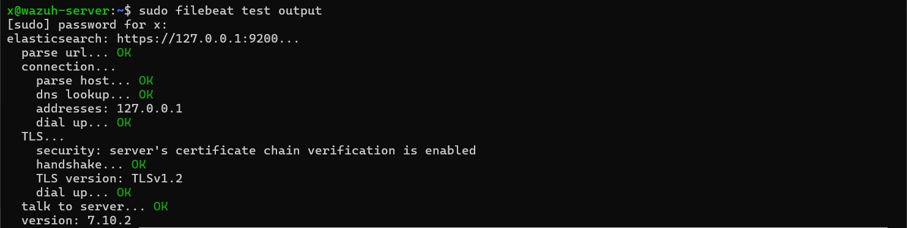

**Le dashboard** est accessible sur `https://192.168.58.162` (certificat auto-signé, d'où l'alerte « Non sécurisé »). Connexion avec le compte `admin` du dashboard (pas le compte Linux).

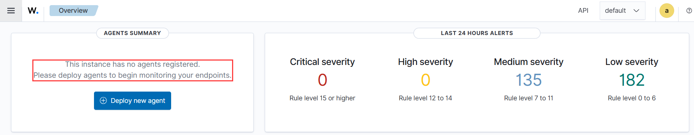

0 agent pour l'instant. Les alertes déjà présentes viennent du serveur lui-même : le manager se surveille aussi.

## Job 03 – VM Debian, agents et règles de surveillance

### Les 2 VM agents

Clonées depuis ma VM modèle Debian 13 (sans interface graphique) : 1 vCPU, 1 Go de RAM, 20 Go, NAT.

| VM | IP |
|---|---|
| debian-agent1 | 192.168.58.152 |
| debian-agent2 | 192.168.58.164 |

Sur chaque clone, je change ce qui doit être unique : le nom, le `machine-id` et les clés SSH.

```bash
sudo hostnamectl set-hostname debian-agent1
sudo sed -i "s/debian13/$(hostname)/g" /etc/hosts
sudo rm /etc/machine-id && sudo systemd-machine-id-setup
sudo rm /etc/ssh/ssh_host_* && sudo dpkg-reconfigure openssh-server
```

Après ça, SSH m'a affiché `REMOTE HOST IDENTIFICATION HAS CHANGED` : normal, la clé du serveur a changé. J'ai vérifié que l'empreinte affichée était bien celle générée par la VM avant d'accepter (`ssh-keygen -R <IP>` puis reconnexion).

### Installation de l'agent

Même version que le manager (`4.14.10-1`), bloquée avec `apt-mark hold` pour qu'une mise à jour ne la rende pas plus récente que le serveur.

```bash
sudo apt-get update && sudo apt-get install -y gnupg curl
curl -s https://packages.wazuh.com/key/GPG-KEY-WAZUH | sudo gpg --no-default-keyring --keyring gnupg-ring:/usr/share/keyrings/wazuh.gpg --import
sudo chmod 644 /usr/share/keyrings/wazuh.gpg
echo "deb [signed-by=/usr/share/keyrings/wazuh.gpg] https://packages.wazuh.com/4.x/apt/ stable main" | sudo tee /etc/apt/sources.list.d/wazuh.list
sudo apt-get update
sudo WAZUH_MANAGER="192.168.58.162" WAZUH_AGENT_NAME="$(hostname)" apt-get install -y wazuh-agent=4.14.10-1
sudo apt-mark hold wazuh-agent
sudo systemctl daemon-reload && sudo systemctl enable --now wazuh-agent
```

Les 2 agents sont connectés au serveur :

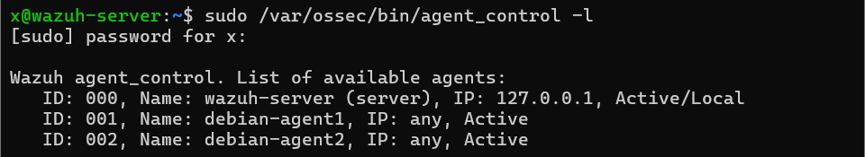

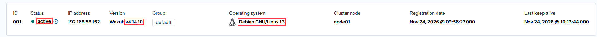

### Ce qui est surveillé par défaut

```bash
sudo grep -nE "<directories|<frequency>|full_command|<alias>|syscollector|<processes>|<ports" /var/ossec/etc/ossec.conf
which netstat ss
```

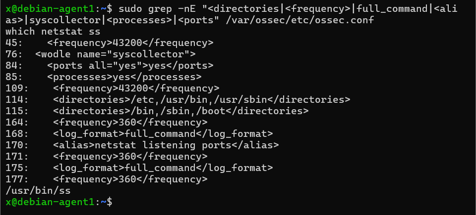

Constats :
- **Fichiers** : `/etc`, `/usr/bin`, `/usr/sbin`, `/bin`, `/sbin`, `/boot`, mais vérifiés seulement **toutes les 12 h** (`43200` s).
- **Processus** : inventaire par syscollector, toutes les heures.
- **Réseau** : une commande `netstat` toutes les 6 min… mais **`netstat` n'est pas installé** sur Debian 13 (seul `ss` existe). La surveillance des ports ne marchait donc pas du tout.

### Ma configuration

Je configure **une seule fois sur le serveur**, dans `/var/ossec/etc/shared/default/agent.conf`. Ce fichier est envoyé automatiquement à tous les agents du groupe `default`.

```xml
<agent_config>

  <!-- FICHIERS : temps réel, avec le détail des modifs dans /etc -->
  <syscheck>
    <directories realtime="yes" check_all="yes" report_changes="yes">/etc</directories>
    <directories realtime="yes" check_all="yes">/usr/bin,/usr/sbin,/root</directories>
  </syscheck>

  <!-- PROCESSUS : inventaire toutes les 5 min (au lieu de 1 h) -->
  <wodle name="syscollector">
    <interval>5m</interval>
    <processes>yes</processes>
    <ports all="yes">yes</ports>
  </wodle>

</agent_config>
```

Vérification : `sudo /var/ossec/bin/verify-agent-conf` → `OK`. Les agents ont bien reçu la config (`Monitoring path: '/etc' … realtime`) :

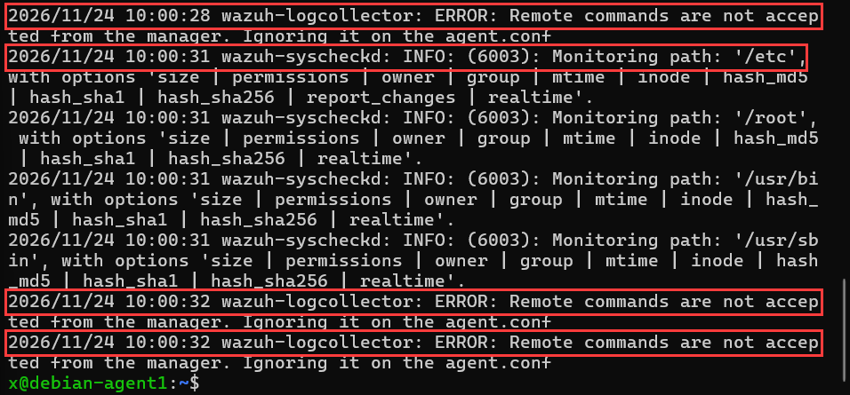

**Pour le réseau**, j'avais aussi mis la commande `netstat` dans `agent.conf`, mais les agents l'ont refusée : `Remote commands are not accepted from the manager`. C'est une protection : si le serveur était piraté, il ne pourrait pas faire exécuter n'importe quelle commande sur tous les postes. J'ai choisi de **ne pas** lever cette protection. À la place, sur chaque agent :

```bash
sudo apt-get install -y net-tools      # installe netstat
sudo sed -i '/<alias>netstat listening ports<\/alias>/{n;s/<frequency>360</<frequency>60</}' /var/ossec/etc/ossec.conf
sudo systemctl restart wazuh-agent
```

La règle Wazuh **533** compare la sortie de cette commande d'une fois sur l'autre et alerte dès qu'un port s'ouvre ou se ferme.

### Tests

Sur debian-agent1 :

```bash
echo "parametre=1" | sudo tee /etc/test-edr.conf     # création
sleep 5; echo "parametre=2" | sudo tee /etc/test-edr.conf   # modification
sleep 5; sudo rm /etc/test-edr.conf                  # suppression
nc -lk 4444 &                                        # ouverture d'un port (comme une backdoor)
```

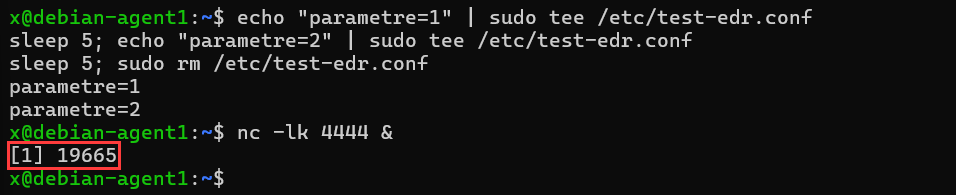

Résultat côté serveur :

| Test | Règle | Description |
|---|---|---|
| Création du fichier | 554 | File added to the system |
| Modification | 550 | Integrity checksum changed |
| Suppression | 553 | File deleted |
| Port 4444 ouvert | 533 | Listened ports status (netstat) changed |

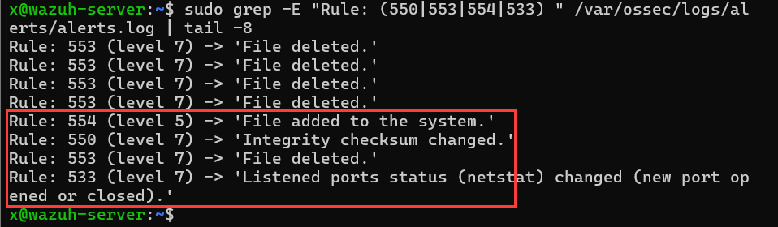

Détail de l'alerte 550 : mode `realtime`, et les empreintes (md5, sha1, sha256) ont changé.

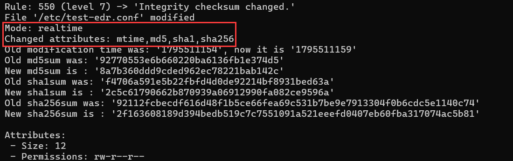

`report_changes` devait aussi afficher le contenu modifié (`parametre=1` → `parametre=2`), mais l'alerte ne le montre pas. Je n'ai pas trouvé pourquoi : la modification est quand même prouvée par les empreintes et la date.

Dans le dashboard, les 3 événements sur le fichier (File Integrity Monitoring) :

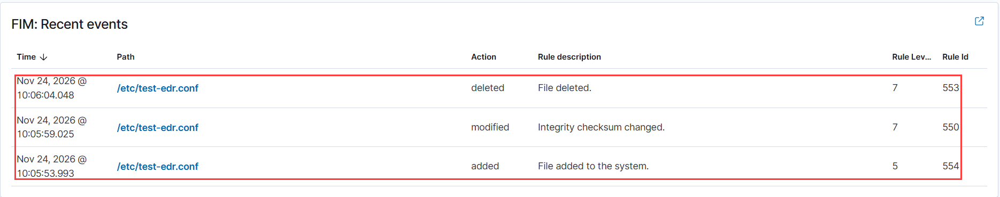

L'alerte réseau (Threat Hunting, `rule.id:533`) :

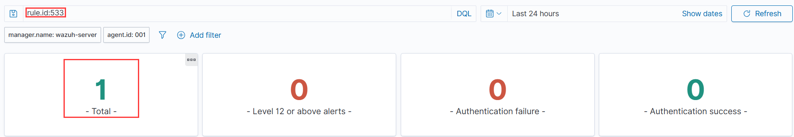

Le détail des 2 alertes 533 : Wazuh compare la liste des ports avec la précédente.

- 09:06:48 UTC : la ligne `tcp 0.0.0.0:4444 … 19665/nc` **apparaît** → port ouvert

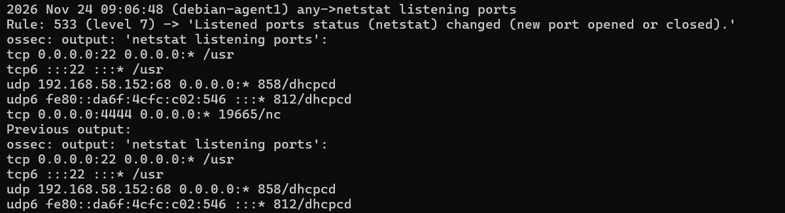

- 09:18:49 UTC, après `kill %1` : la ligne **disparaît** → port fermé

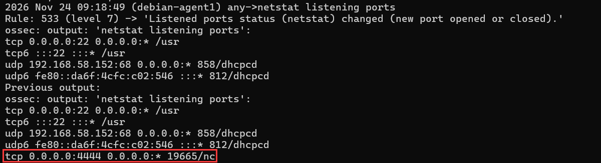

Le processus `nc` dans l'inventaire (IT Hygiene → Processes). Le PID `19665` est bien celui affiché par le shell au lancement :

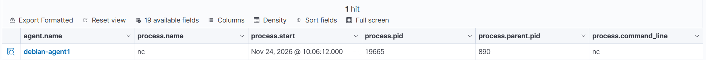

**Constat sur le serveur :** j'ai eu 4 alertes « File deleted » sur des fichiers de `/etc/wazuh-indexer/backup/`, datées de 08:23:22 UTC, alors que je n'avais rien fait à ce moment-là. Explication trouvée dans les logs :
- à 08:23:22, le serveur termine son contrôle FIM programmé (`File integrity monitoring scan ended`). Sur le serveur, le FIM n'est **pas** en temps réel : un contrôle toutes les 12 h ;
- seul l'outil `wazuh-passwords-tool.sh` utilise ce dossier : il y fait des sauvegardes puis les supprime. Je l'avais lancé la veille.

L'heure d'une alerte FIM sans temps réel, c'est donc l'heure où Wazuh **remarque** le changement, pas l'heure du changement. C'est pour ça que j'ai mis `realtime` sur les agents.

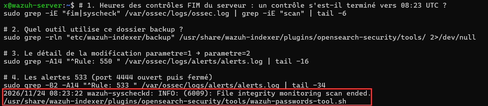

Autre détail : chaque commande `sudo` est elle-même enregistrée et remonte en alerte dans Wazuh. Mes `sudo grep` sur les alertes apparaissaient donc dans les résultats.

**Limite :** pour les processus, Wazuh fait un **inventaire** (toutes les 5 min), pas une alerte. Un processus lancé puis arrêté entre deux inventaires ne sera pas vu. Une règle d'alerte sur un processus précis sera le sujet du Job 05.

## Job 04 – Attaque simulée et rapport d'incident

### Le scénario

Je simule un intrus qui :
1. essaie de deviner le mot de passe SSH de `debian-agent1` (plusieurs mauvais mots de passe) ;
2. finit par se connecter ;
3. crée un compte `support` et l'ajoute au groupe `sudo` (pour garder un accès administrateur).

Attaquant : `debian-agent2` (192.168.58.164). Victime : `debian-agent1` (192.168.58.152).

Les tentatives sont faites à la main (`ssh x@192.168.58.152` + mauvais mot de passe, 3 essais par connexion).

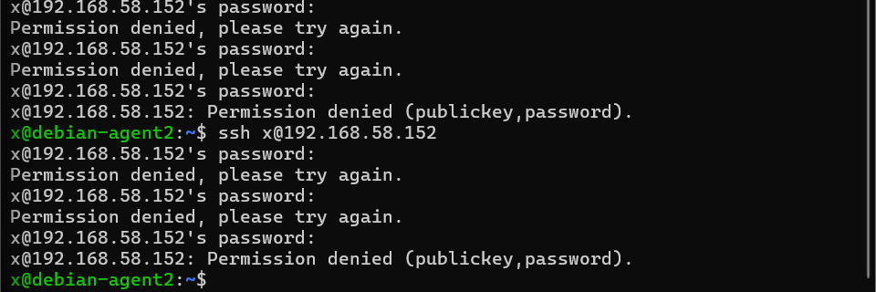

Actions de l'intrus une fois connecté :

```bash
sudo adduser support
sudo usermod -aG sudo support
```

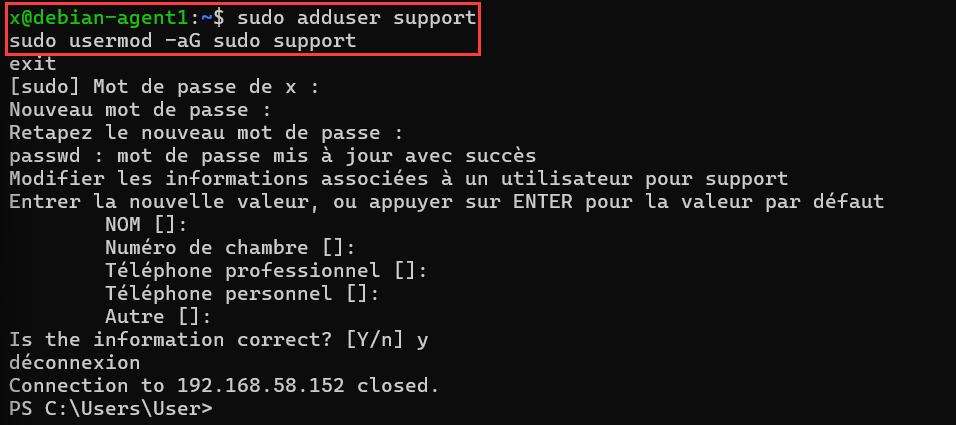

**Erreur de ma part :** mon premier essai est parti de mon PC (PowerShell) et pas d'agent2. Wazuh l'a vu avec l'IP `192.168.58.1` (mon PC sur le réseau NAT VMware). J'ai refait les échecs depuis agent2 : Wazuh distingue bien les deux sources.

### Ce que Wazuh a détecté

Vue d'ensemble dans le dashboard (agent1, 15 dernières minutes) :

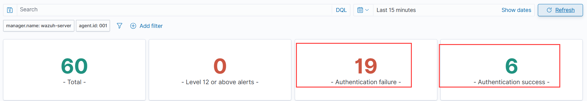

Toutes les règles déclenchées sur agent1 (sans l'audit CIS, qui n'a rien à voir avec l'attaque) :

```bash
sudo grep -A1 "debian-agent1" /var/ossec/logs/alerts/alerts.log | grep "^Rule:" | grep -vE "Rule: 190(0[0-9])" | sort | uniq -c | sort -rn
```

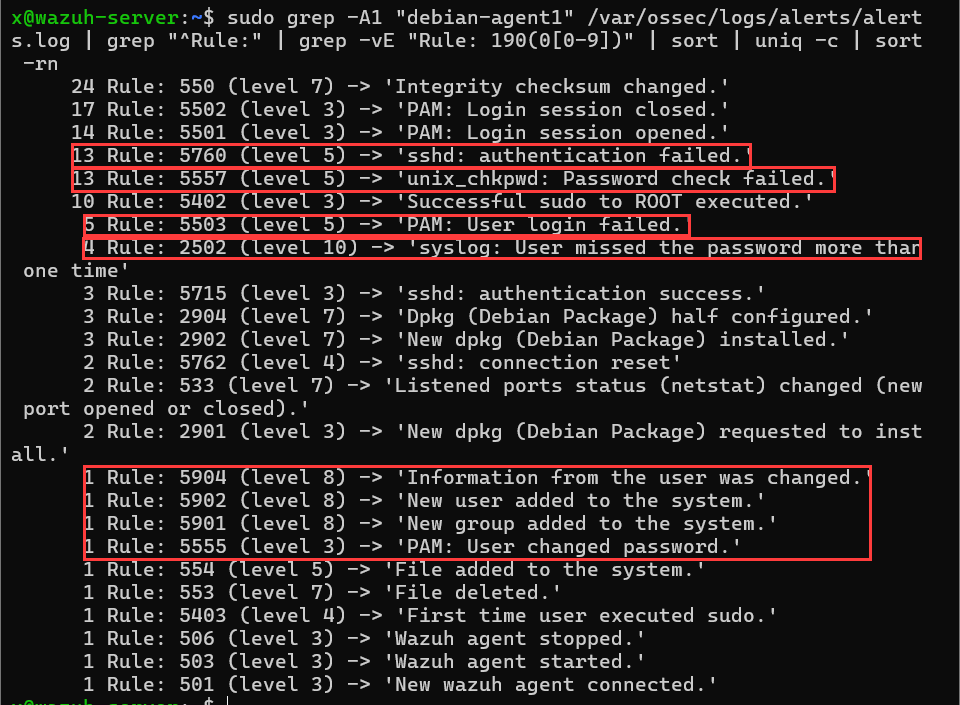

| Étape de l'attaque | Règles Wazuh |
|---|---|
| Mauvais mots de passe | 5760 `sshd: authentication failed`, 5557 `Password check failed`, 5503 `User login failed` |
| Plusieurs échecs d'affilée | **2502** (niveau 10) `User missed the password more than one time` |
| Connexion réussie | 5715 `sshd: authentication success` |
| Création du compte | **5902** `New user added`, 5901 `New group added`, 5555 `User changed password`, 5904 `Information from the user was changed` (fiche du compte remplie par `adduser`, via `chfn`) |
| Ajout au groupe sudo | **aucune alerte dédiée** : seulement `/etc/group` et `/etc/gshadow` modifiés (FIM, 550) |
| Utilisation de sudo | 5402 `Successful sudo to ROOT` |

L'alerte la plus grave (niveau 10) donne l'**IP de l'attaquant** :

```bash
sudo grep -B1 -A4 -E "^Rule: [0-9]+ \(level 1[0-5]\)" /var/ossec/logs/alerts/alerts.log | grep -E "^20|^Rule:|^Src IP" | tail -12
```

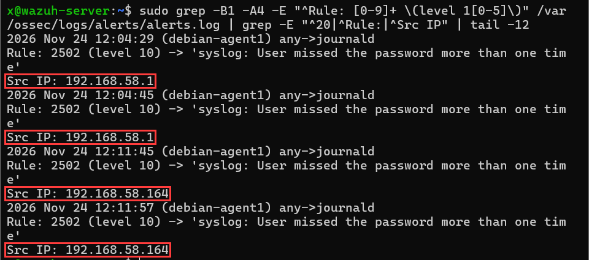

La surveillance des fichiers en temps réel (Job 03) a aussi vu la création du compte, via les fichiers de comptes modifiés dans `/etc` :

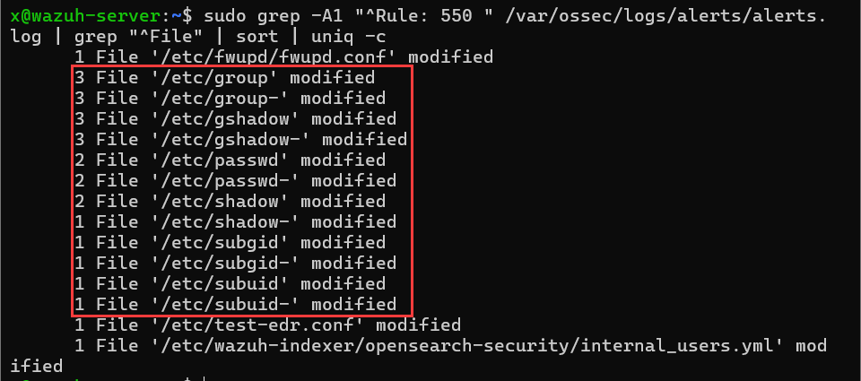

### Chronologie (heure UTC)

| Heure | Événement | Source |
|---|---|---|
| 12:04:29 et 12:04:45 | Échecs SSH répétés (2502) | 192.168.58.1 (mon PC, 1er essai) |
| juste après | Connexion réussie, création de `support`, ajout à `sudo` | 192.168.58.1 |
| 12:11:45 et 12:11:57 | Échecs SSH répétés (2502) | **192.168.58.164 (agent2)** |

### Constats

- Wazuh a vu les échecs, la connexion et la création du compte.
- **L'ajout au groupe `sudo`, l'action la plus grave, n'a déclenché aucune alerte à son nom.** Il n'apparaît qu'indirectement, comme une modification de `/etc/group` (niveau 7, comme n'importe quel fichier modifié). Au départ, j'avais attribué l'alerte 5904 à cet ajout : en lisant le log brut, elle venait en fait de `chfn` (la fiche du compte remplie pendant `adduser`).
- Mais **rien n'a été bloqué** : Wazuh alerte, il ne réagit pas tout seul par défaut. L'intrus a pu créer son compte.
- La règle « force brute SSH » (5763) **ne s'est pas déclenchée**. Dans sa définition, il faut **8 échecs SSH (règle 5760) en 120 secondes, depuis la même IP** (`frequency="8" timeframe="120"`, `same_source_ip`). Avec mes essais à la main (6 depuis agent2), je suis en dessous. C'est la 2502 (niveau 10) qui a remonté l'alerte la plus grave.

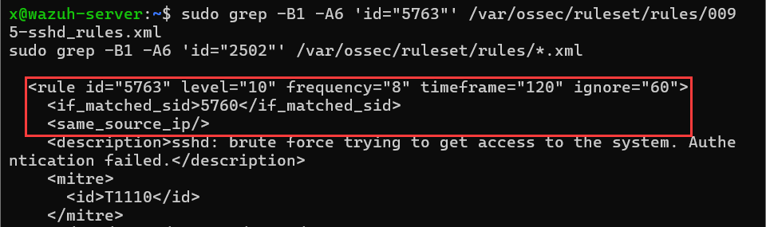
- Au passage, Wazuh fait aussi un audit de configuration (CIS Debian 13) : score **41 %** (pas d'`auditd`, pas d'AppArmor activé…).

### Mesures de réponse proposées

**Tout de suite (remédiation) :**
- supprimer le compte créé : `sudo deluser --remove-home support` ;
- changer le mot de passe du compte `x` ;
- bloquer l'IP de l'attaquant (192.168.58.164) → automatisé au Job 06.

**Pour éviter que ça recommence :**
- SSH par **clé** uniquement (`PasswordAuthentication no`) : plus de mot de passe à deviner ;
- bloquer automatiquement une IP après plusieurs échecs (réponse active Wazuh, Job 06) ;
- alerte prioritaire sur toute création de compte ou ajout au groupe `sudo` (règle personnalisée, Job 05).

## Job 05 – Règle de détection personnalisée

### Le problème (vu au Job 04)

L'ajout du compte de l'intrus au groupe `sudo` n'a déclenché **aucune alerte**. Pourtant l'agent a bien reçu la ligne de log :

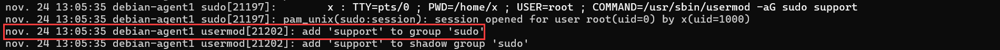

Test avec `wazuh-logtest` (on lui donne une ligne de log, il dit quelle règle s'applique) : Wazuh reconnaît le programme `usermod`, mais **aucune règle** ne correspond, donc pas d'alerte.

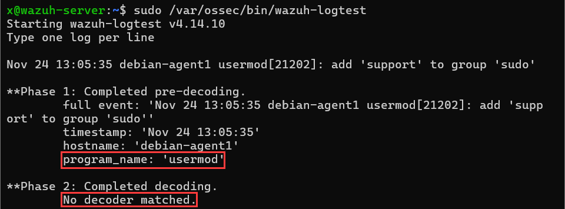

### Ma règle

Dans `/var/ossec/etc/rules/local_rules.xml` (le fichier prévu pour les règles maison, sur le serveur) :

```xml
<!-- Job 05 : alerte critique quand un compte est ajouté au groupe sudo -->
<group name="local,syslog,privilege_escalation,">
  <rule id="100100" level="12">
    <program_name>usermod</program_name>
    <match>to group 'sudo'</match>
    <description>Compte ajouté au groupe sudo (droits administrateur)</description>
    <mitre>
      <id>T1098</id>
    </mitre>
  </rule>
</group>
```

- `id="100100"` : à partir de 100000 = règles personnalisées ;
- `level="12"` : critique ;
- la ligne doit venir de `usermod` **et** contenir `to group 'sudo'` (la 2e ligne `to shadow group 'sudo'` ne correspond pas → une seule alerte par ajout) ;
- `T1098` : technique MITRE ATT&CK « Account Manipulation ».

### Test sans toucher aux VM

Même ligne dans `wazuh-logtest` : la règle 100100 se déclenche, niveau 12, classée MITRE *Persistence / Account Manipulation*.

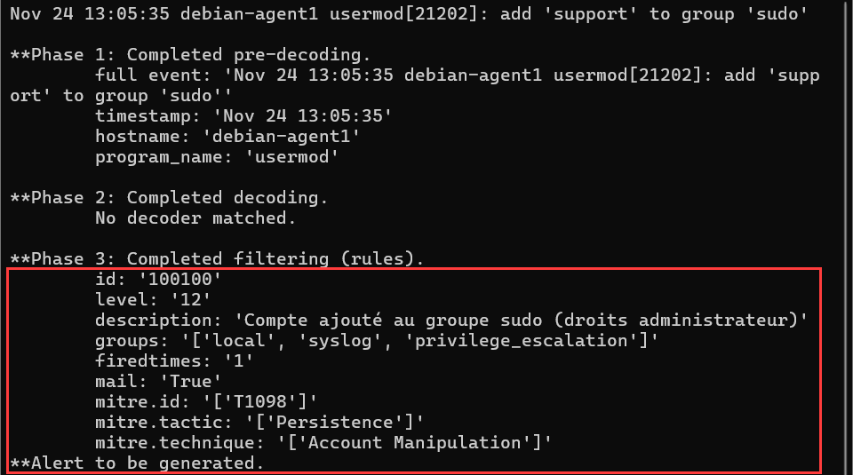

### Test réel

```bash
# serveur : charger la règle
sudo systemctl restart wazuh-manager

# agent1 : compte de test sans mot de passe, ajouté à sudo, puis supprimé
sudo adduser --disabled-password --comment "" test-sudo
sudo usermod -aG sudo test-sudo
sudo deluser --remove-home test-sudo
```

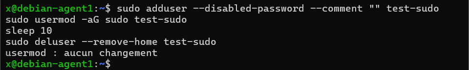

L'alerte arrive sur le serveur :

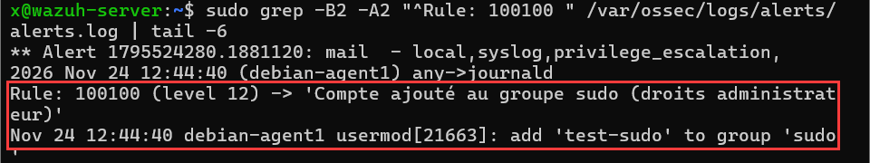

Et dans le dashboard (Threat Hunting, `rule.id:100100`) :

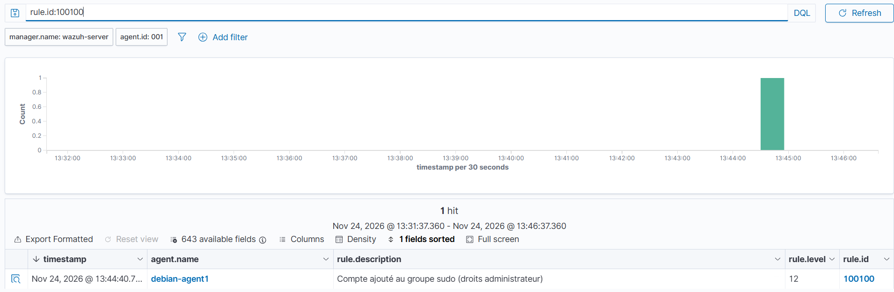

**À noter :** Wazuh marque l'alerte « mail » (envoi d'un email à partir du niveau 12), mais je n'ai pas configuré d'envoi d'email.

**Limite :** la règle ne surveille que le groupe `sudo`. Sur d'autres systèmes, le groupe admin s'appelle `wheel` ou `admin` : il faudrait les ajouter.

## Job 06 – Réponse active automatisée

Objectif : qu'une attaque par force brute SSH soit **bloquée automatiquement**, sans intervention humaine. Au Job 04, Wazuh voyait l'attaque mais ne faisait rien.

### Quelle règle déclenche le blocage ?

J'ai hésité entre deux règles vues au Job 04 :

| | 5763 | 2502 |
|---|---|---|
| Ce qu'elle détecte | force brute **SSH** : 8 échecs en 120 s depuis la même IP | « mot de passe raté plusieurs fois » (PAM, tous services) |
| IP source | toujours (SSH) | pas toujours (`sudo` ou `su` en local : pas d'IP à bloquer) |
| Seuil | 8 échecs | dès 2-3 fautes de frappe sur une connexion |
| Doc officielle Wazuh | **oui**, c'est leur exemple | non |

→ **5763**. Avec la 2502, un admin qui se trompe deux fois de mot de passe serait bloqué.

### Ce qu'il fallait vérifier avant

Le script `firewall-drop` utilise **iptables**. Or Debian 13 utilise nftables, et iptables n'était **pas installé** sur les agents. Sans lui, le blocage aurait échoué sans aucun message.

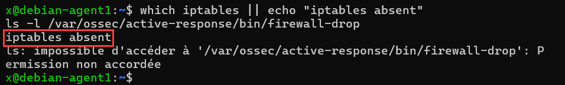

```bash
sudo apt-get install -y iptables     # sur les 2 agents
```

Côté serveur, la commande `firewall-drop` existe déjà. La **liste blanche** (IP jamais bloquées) ne contenait que des adresses locales :

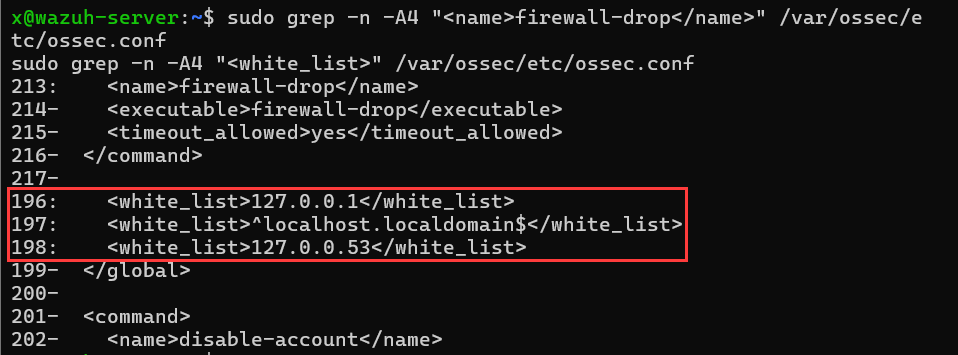

### Configuration (sur le serveur, `/var/ossec/etc/ossec.conf`)

J'ajoute mon PC (`192.168.58.1`) à la liste blanche, pour ne jamais me bloquer moi-même, puis la réponse active :

```xml
<ossec_config>
  <active-response>
    <command>firewall-drop</command>
    <location>local</location>
    <rules_id>5763</rules_id>
    <timeout>180</timeout>
  </active-response>
</ossec_config>
```

- `location local` : l'action s'exécute sur l'agent attaqué ;
- `rules_id 5763` : déclenchée par la règle de force brute SSH ;
- `timeout 180` : IP bloquée 3 minutes, puis débloquée toute seule.

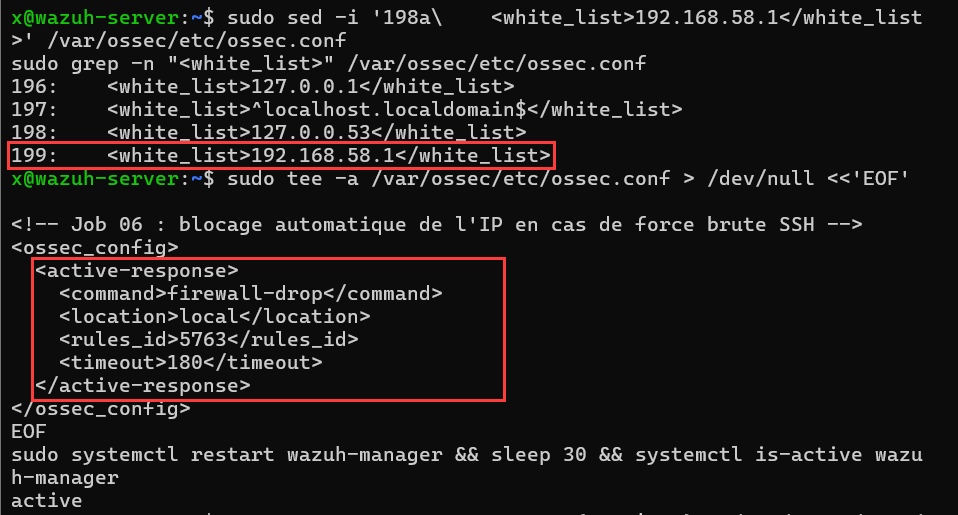

### Test

Depuis agent2 : 3 connexions SSH avec de mauvais mots de passe. Au 8e échec, la connexion se fige. La suivante ne passe plus du tout :

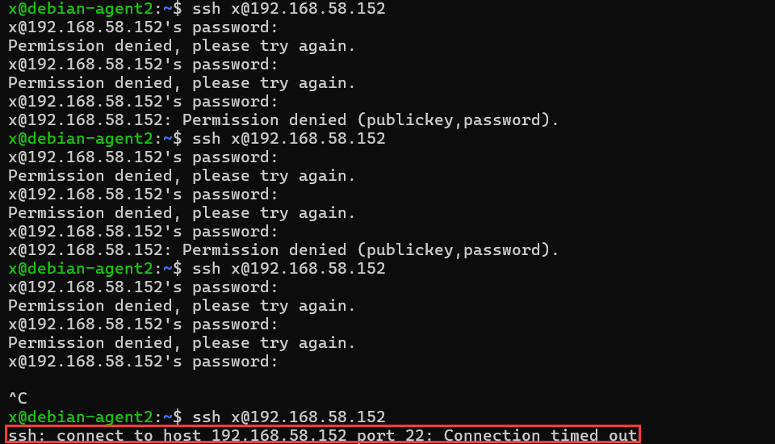

Pendant le blocage, sur agent1, iptables rejette tout ce qui vient d'agent2 :

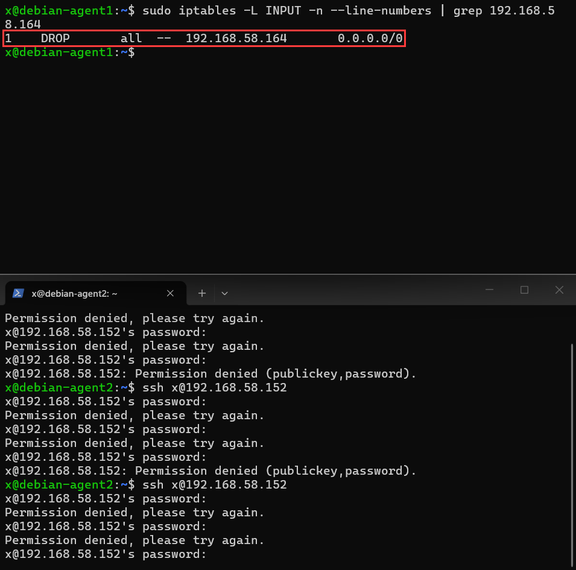

Côté serveur : la règle 5763, puis la confirmation du blocage (règle 651) :

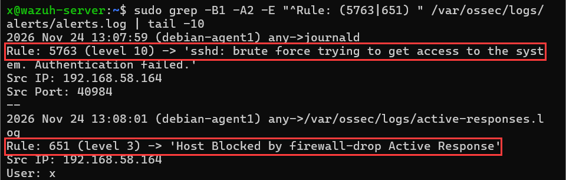

Le journal des réponses actives sur agent1 : le blocage (`Ended` à 14:07:59), puis le déblocage automatique 3 minutes plus tard (`"command":"delete"` à 14:11:00). On y voit aussi les 8 échecs qui ont déclenché la règle :

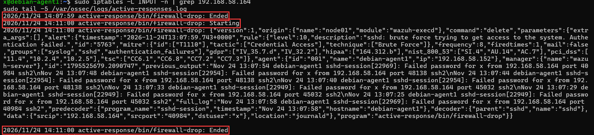

Après les 3 minutes, plus de règle dans iptables :


### Chronologie (heure UTC)

| Heure | Événement |
|---|---|
| 13:07:25 → 13:07:58 | 8 échecs SSH depuis 192.168.58.164 (en 33 secondes) |
| 13:07:59 | Règle **5763** (niveau 10) → `firewall-drop` s'exécute sur agent1 |
| 13:08:01 | Règle **651** « Host Blocked by firewall-drop Active Response » |
| juste après | `ssh: connect to host … Connection timed out` depuis agent2 |
| 13:11:00 | Déblocage automatique (`delete`), SSH remarche |

### Limites

- Le blocage ne dure que 3 minutes : un attaquant patient peut recommencer. En production, on mettrait un délai plus long, ou on bloquerait définitivement après plusieurs récidives.
- `location local` : seul agent1 bloque l'attaquant. Avec `location all`, tous les agents le bloqueraient.
- En dessous de 8 échecs en 2 minutes (mon 1er essai, avec seulement 3 échecs), rien n'est bloqué : une attaque lente passe sous le seuil.

Sources : [Wazuh – Blocking SSH brute-force attack with Active Response](https://documentation.wazuh.com/current/user-manual/capabilities/active-response/ar-use-cases/blocking-ssh-brute-force.html), [Wazuh – Default active response scripts](https://documentation.wazuh.com/current/user-manual/capabilities/active-response/default-active-response-scripts.html)

## Problèmes rencontrés

### 1. Mauvaise version d'Ubuntu

J'ai d'abord installé Ubuntu 26.10 sans le faire exprès : c'était l'ISO proposée par défaut sur le site. Je l'ai vu dans le log d'installation, qui téléchargeait depuis `stonking-updates` avec un noyau 7.3. Or Wazuh 4.14 ne supporte officiellement Ubuntu que jusqu'à la 24.04.
→ J'ai recommencé avec `ubuntu-24.04.5-live-server-amd64.iso`.

### 2. Installation d'Ubuntu bloquée sur « installing kernel »

Le log affichait des lignes `Ign:` (téléchargement raté) sur des paquets venant de `archive.ubuntu.com`, et l'installation n'avançait plus.

Tests faits depuis le shell de l'installateur :

| Test | Résultat |
|---|---|
| `ping -c3 8.8.8.8` | 0 % de perte, ~18 ms → la VM et le NAT VMware fonctionnent |
| `ping -c3 archive.ubuntu.com` | 66 % de perte, 218 ms (serveur `ubuntu-mirror-3.ps6.canonical.com`) |
| `ip -6 route` | seulement `fe80::` → pas d'IPv6, donc l'IPv6 n'est pas en cause |
| `ping -c3 fr.archive.ubuntu.com` | 0 % de perte, 44 à 152 ms |

Conclusion : le problème vient du serveur `archive.ubuntu.com` vers lequel j'étais envoyé, pas de ma VM.
→ J'ai refait l'installation **sans réseau** (carte réseau débranchée dans VMware) : tout vient de l'ISO, ça a pris environ 5 minutes. J'ai mis le miroir `fr.archive.ubuntu.com` et fait les mises à jour après.

### 3. Pas de réseau après l'installation sans réseau

`ip a` montrait `ens33` en `state DOWN` : l'installateur n'avait configuré aucune interface. J'ai créé `/etc/netplan/01-ens33.yaml` :

```yaml
network:
  version: 2
  ethernets:
    ens33:
      dhcp4: true
```

puis `sudo netplan apply` → `ens33` a obtenu `192.168.58.162`.

Autre détail : l'installateur n'avait donné que 23 Go sur 50 Go au système (LVM). Corrigé avec :

```bash
sudo lvextend -r -l +100%FREE /dev/ubuntu-vg/ubuntu-lv
```

### 4. Plantage de VMware après une mise en veille

Le PC s'est mis en veille pendant l'installation. Au réveil, VMware a affiché « Erreur irrécupérable (svga) », et la VM ne voulait plus redémarrer (« toutes les instances des canaux de communication sont occupées »), sans doute parce que l'ancien processus de la VM tournait encore.
→ J'ai désactivé l'accélération 3D de la VM et la mise en veille du PC sur secteur (`powercfg /change standby-timeout-ac 0`).

### 5. Installation de l'agent ratée sur les clones (paquets introuvables)

Première tentative : `apt-get install gnupg curl` → `404 Not Found`. La liste des paquets de ma VM modèle était trop vieille (`apt` indiquait « Version de 13.6 à 13.8 ») : elle demandait des versions qui n'existent plus sur le serveur Debian. Donc pas de `curl` ni de `gpg`, donc pas de clé Wazuh, donc dépôt Wazuh refusé (« n'est pas signé »), donc pas d'agent.
→ Il faut toujours faire `apt-get update` en premier sur une VM clonée. J'ai aussi dû supprimer le fichier `wazuh.list` créé sans clé, sinon `apt-get update` restait en erreur.
